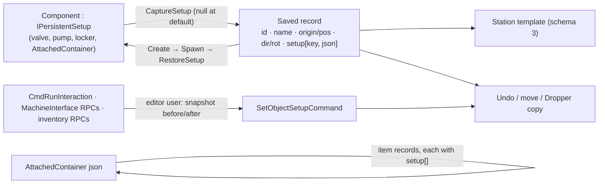

> Implements: Documents/design/creative-mode.md §3, §9; Documents/design/persistence-save.md §3; Documents/design/inventory-storage.md §7, §8
> Touches systems: persistence, tile, map-editor-creative-hooks, atmospherics, inventory, interactions, furniture
> Status: planned

**Progress:** not started. Advances [map-authoring.md](../milestones/map-authoring.md) A9.

# Object setup persistence (Nov 2026)

A mapper sets up an object in the Map Editor, for example opening a valve or filling a locker, and the saved station keeps it. Each placed object's **setup** goes into the station template next to its asset, position and facing. Setup means device settings, locks and container contents. Stored resources, damage and live simulation never do. Scope was settled in a grill on 2026-11-13/14: rounds 1–2 at the gameplay altitude (Q1–Q9), rounds 3–5 at the implementation altitude (Q10–Q25).

## Starting state (2026-11-14, `419659d6b`)

- **Nothing per-object is saved.** `SavedPlacedTileObject` holds `id`, `tileObjectSOName`, `origin` and `dir`; `SavedPlacedItemObject` holds `id`, `itemName`, `worldPosition` and `rotation` (`Assets/Scripts/SS3D/Systems/Tile/SavedObjects/`).
- **Prefab defaults are applied at spawn.** `AtmosValveController.OnStartServer` calls `ServerSetEnabled(_startsOpen)`, so every valve loads at its prefab default. `PlacedTileObject.Create` instantiates, calls `Setup`, then `ServerManager.Spawn`.
- **Container contents are dropped on save.** `AttachedContainer` removes an item's `PlacedItemObject` when the item is stored, and `TileMap.Save` writes only `_items`, which are world items. Contents are a `SyncList<StoredItem>` (`Item` plus grid `Position`); one object can carry several containers, each with a `ContainerName`. No mechanism for starting contents exists.
- **Undo forgets setup.** `ClearTileCommand` and `DisplacedTiles` restore an object from asset, position and direction only (`MapEditor/Commands/MapEditorCommands.cs`). The same holds for move commands.
- **Unsaved-change tracking only sees editor commands.** `MapEditorUndoStack` revisions drive the Stop prompt and the round-end autosave. An in-world interaction never goes through that stack.
- **In-world changes reach the server three ways:**
  - interactions, through `InteractionController.CmdRunInteraction`
  - machine panels, through the `MachineInterfaceBehaviour` ServerRpcs
  - inventory moves, through ServerRpcs on `Hands`, `Hand`, `HumanInventory` and `ContainerViewer`
- **Nothing reads `schemaVersion` on load.** `PersistenceSubSystem` writes `PersistenceEnvelope.CurrentSchemaVersion` (2) but never compares it, so an older build loads a newer map silently. `JsonUtility` drops unknown fields.
- **Load loss is counted per asset name** in `TileMap.LastLoadSkipped`, and the map editor's load toast shows it.
- **Devices with settable state:**
  - manual and digital valves (`AtmosValveController`)
  - `AtmosPumpController`
  - `VentController` (`_targetPressureKpa`)
  - `ScrubberController`
  - `AtmosFilterController`
  - `AtmosMixerController`
  - the air alarm's preset (`AirAlarmController._activeMode`)
  - `Locker` (`IsOpen`, `IsLocked`)

  No airlock bolt or weld state exists.

## Decisions

### Gameplay (premises)

| # | Decision |
|---|---|
| Q1 | **Save what you see.** A mapper sets an object up through its own in-world interface, as a player would ([creative-mode.md](../design/creative-mode.md) §3), and saving records it. Objects with no in-world interface get editor fields instead, as areas and spawn points already do. Palette variants ("Valve (open)") are rejected: they multiply with every setting and can't express contents. |
| Q2 | **Saved:** device settings (valve, pump target, vent and scrubber mode, air alarm preset), locks and open state, container contents. **Never saved:** stored resources (SMES or cell charge, fuel, canister and tank gas; [creative-mode.md](../design/creative-mode.md) §3 "devices start in their default state"), damage and wear (the milestone's "no battle damage"), live simulation (gas in pipes, power flow, timers). |
| Q3 | Device settings first, then contents. |
| Q4 | A setup change made by someone with the editor open becomes an undo step owned by that user and marks the map unsaved. Changes made while playtesting aren't tracked, but a later save captures them, the same as moved items. |
| Q5 | Dropper and copy carry setup and contents. Placing from the palette always gives the default object. |
| Q6 | Contents are saved recursively, as deep as the storage rules allow ([inventory-storage.md](../design/inventory-storage.md) §7). |
| Q7 | Editor users can lock and unlock a locker without an ID. Who has access stays whatever the prefab or room says; per-door access stays deferred ([map-authoring.md](../milestones/map-authoring.md)). |
| Q8 | Saved setup is exact. Randomised contents (SS13 loot spawners) is a separate later design. |
| Q9 | The owner revises [persistence-save.md](../design/persistence-save.md) §3 to say templates hold each object's authored setup, and [inventory-storage.md](../design/inventory-storage.md) §14 to point at it. [creative-mode.md](../design/creative-mode.md) stays unchanged. |

### Implementation

| # | Decision |
|---|---|
| Q10 | Setup lives **on the object's own save record**: `SavedPlacedTileObject` and `SavedPlacedItemObject` each gain a `setup` list. Undo records, move commands, Dropper copy and nested contents all reuse this one record shape. A separate setup section keyed by position is rejected because the key breaks whenever an object moves or rotates. |
| Q11 | Components implement an explicit **`IPersistentSetup`**: `string SetupKey`, `string CaptureSetup()`, `void RestoreSetup(string json)`. A record entry is `{ key, json }`, the same JSON-in-a-string pattern the envelope's `payloadJson` uses. It's **sparse**: `CaptureSetup` returns `null` at the prefab default, so a prefab default change reaches every map that didn't override it. A reflection-based `[MapSetting]` attribute is rejected. |
| Q12 | Setup is applied **right after spawn**. `PlacedTileObject.Create` and the item placement path take an optional setup list and call `RestoreSetup` right after `ServerManager.Spawn`, overriding the defaults `OnStartServer` set. `RestoreSetup` must be safe to call twice. |
| Q13 | `AttachedContainer` implements `IPersistentSetup`, keyed by `ContainerName`. Its JSON is a list of item records: asset id, name, grid position, and the item's own setup list. Nested containers recurse through that list, and because each level is a string inside its parent's, `JsonUtility`'s depth limit never applies. Restore spawns items straight into the container with `AddItemPosition`; stacks are saved one item each and re-merge on add. An AssetAudit test checks `ContainerName` is unique within each prefab that has more than one container. |
| Q14 | At the three server entry points, when the caller has the editor open, the server captures the setup of the objects involved before and after the action. For an inventory move that's the source and destination container owners. If anything differs, it pushes a **`SetObjectSetupCommand(before, after)`** owned by the caller. Normal play pays nothing. |
| Q15 | On a copy, the sandbox rules (`MapEditorSandboxRules`: nuke and disk) are checked against **every nested item**, and the whole copy is refused if any item fails. `MapEditorRateLimiter` charges one operation per item placed, contents included. |
| Q16/Q18 | `PersistenceEnvelope.CurrentSchemaVersion` goes from 2 to 3 (MINOR by [2026-10_game-versioning](2026-10_game-versioning.md)). Loading compares versions: a map saved with a newer version still loads, but shows a toast saying it was saved by a newer version and some settings may be missing. The versioning doc's bump rule gains the forward direction: bump when a newer save would lose data in an older build. Old saves need no migration, because no setup entry means the prefab default. Already-released builds still lose setup on new maps; accepted. |
| Q17 | Load-loss reporting: a nested item of a removed type is counted in `LastLoadSkipped` under its asset name, like a world item. A setup entry that can't be restored (unknown key, or JSON that won't parse) is counted once per asset, e.g. "AtmosValveManual settings". The object still loads at its defaults. |
| Q21 | SS13 DMM var-edits are a follow-up (below). |
| Q22 | `IPersistentSetup` is **setup-only**, and its doc comment says so. Round snapshots ([persistence-save.md](../design/persistence-save.md) §6) get their own capture path later and may reuse the record shape, not the interface. A snapshot writing through this interface would put charge and damage into templates. |
| Q23 | **One PR**, built in the two slices below, in order. |
| Q24 | Slice 1 covers every device in Starting state's list: valves, pump, vent, scrubber, filter, mixer, air alarm preset, locker. Room lights stay a room setting (`SavedAreaRecord.lightingSwitchOn`); APC charge is a stored resource. |
| Q25 | Tests per [Tests](#tests). |

## Shape

New types (names are proposals):

- `IPersistentSetup` and `SavedSetupEntry { string key; string json; }`, in `Assets/Scripts/SS3D/Data/Persistence/` next to the envelope, because Tile, Atmospherics and Inventory all implement it.
- `ObjectSetup.Capture(GameObject)` and `ObjectSetup.Restore(GameObject, IReadOnlyList<SavedSetupEntry>, LoadReport)`: walk the object's `IPersistentSetup` components, reject duplicate keys, report entries they can't restore.
- `SetObjectSetupCommand` (with a `MapEditorCommandKind` and DTO fields) in `MapEditor/Commands/`. It finds its target by the tile slot or item it was captured from, and reports `Changed` like the other commands.
- `MapEditorSetupTracker`, server-side, owned by `MapEditorSubSystem`: the before/after scope the three entry points call.

## Phases

### Slice 1 — Framework and device settings — **planned**

1. `IPersistentSetup`, `SavedSetupEntry`, `ObjectSetup`; `setup` lists on `SavedPlacedTileObject` and `SavedPlacedItemObject`; `PlacedTileObject.Save` and `PlacedItemObject.Save` fill them.
2. `PlacedTileObject.Create` and item placement take an optional setup list and restore it after `Spawn` (Q12). `TileMap.LoadRoutine` passes saved setup through.
3. Undo and move carry the full record: `RemovedTileRecord` and `DisplacedTiles` capture setup; `MoveTileCommand` and `MoveItemCommand` carry it to the new slot.
4. Implement `IPersistentSetup` on the Q24 devices. Each captures only fields a player can set and returns `null` at the prefab default.
5. Editor attribution (Q14): `MapEditorSetupTracker` and `SetObjectSetupCommand`, hooked into `CmdRunInteraction` and the `MachineInterfaceBehaviour` ServerRpcs. The command goes on `MapEditorUndoStack`, so the Stop prompt and autosave see it.
6. Lock bypass (Q7): `LockLockerInteraction` and `UnlockLockerInteraction` skip the ID check when the actor has the editor open.
7. Dropper copy (Q5): picking a placed object keeps its captured setup alongside the palette selection; `PlaceTileCommand`, `PlaceItemCommand` and their DTOs carry an optional setup list. Placing from the palette clears it.
8. Load loss (Q17) for settings; schema 3 and the newer-version toast (Q18); the forward-direction rule in [2026-10_game-versioning](2026-10_game-versioning.md).

### Slice 2 — Contents — **planned**

1. `AttachedContainer : IPersistentSetup` (Q13), restoring nested item records through `AddItemPosition` and recursing into each item's setup.
2. AssetAudit: `ContainerName` unique within each prefab that has more than one container.
3. Q14 hook on the inventory ServerRpcs (`Hands`, `Hand`, `HumanInventory`, `ContainerViewer`), snapshotting the source and destination owners.
4. Q15: sandbox checks across nested items and rate-limit charging per item, in `RpcExecuteCommands`.
5. Load loss for nested items of removed types (Q17).

## Tests

EditMode:

- Setup round trip through the envelope, sparse: a default object writes no entry; a changed one restores its value.
- Restore runs after `OnStartServer` and wins over `_startsOpen`.
- Undoing a delete, and undoing a move, brings setup back.
- A Dropper copy carries setup; placing from the palette doesn't.
- An unknown setup key and unparsable JSON are counted in `LastLoadSkipped`; the object loads at its defaults.
- A newer `schemaVersion` raises the warning; schema 2 maps load unchanged.
- Slice 2: a three-level nested round trip (locker → backpack → box); a sandbox copy holding the disk is refused whole; the `ContainerName` audit.

PlayMode, one case in `scenarios:MapEditor`: an editor user toggles a valve by hand, the map reads unsaved, undo closes the valve again, and Stop prompts. This crosses FishNet RPCs, which EditMode can't reach ([2026-11_testing-philosophy](2026-11_testing-philosophy.md)).

Validate with `Testing/ui/validate.sh --steps compile,editmode,scenarios:MapEditor`. No visual step.

## Risks to check while building

- **Spawn timing.** Q12 assumes FishNet runs `OnStartServer` before `ServerManager.Spawn` returns. The restore-after-start test confirms it; if that's wrong, apply setup from a post-spawn callback instead.
- **`ContainerName` uniqueness.** It hasn't been verified on every prefab. Run the Slice 2 audit first; a failure is a prefab fix, through a tier-B recipe ([2026-07_agent-first-composition](2026-07_agent-first-composition.md)), never by hand-editing YAML.
- **Copy payload size.** A filled crate's setup travels in the command DTO. Keep FishNet's packet limits in mind for large copies, and split or refuse rather than truncate.

## Follow-ups

- **SS13 DMM var-edits (Q21):** map `open` (valves) and `locked` (lockers) through `Tools/map_import/ss13_type_map.yaml` into setup entries.
- **Randomised contents (Q8):** needs its own design first.
- **Round snapshots (Q22):** a separate capture path under the persistence plan's Phase 2.
- **Airlock bolts and welds:** saved setup once the state exists.
