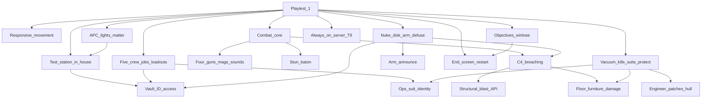

> Goal: Playtest 1 — eight players play Nuclear Operatives rounds on the 24/7 server: ops spawn geared and breach for the disk, a five-job crew fights back, keeps the hull and power up and patches the wounded, and every round ends with a summary and restarts
> Status: in-progress
> Depends on: —
> Current focus: M4 (win/lose rules), M1m (responsive movement), then M0, M1c, M3, M8/M9 thin — session stability, the 24/7 server and smoke live on [test-server.md](test-server.md) T3/T8
> Roadmap: Nuclear Operatives round — Play a full Nuke Ops round from spawn to end screen
> Pillars: 2, 4, 6 (1 thin) — [vision.md](../design/vision.md) §2

# MVP1 — Nuclear Operatives round

## Playable definition

**Done when Playtest 1 passes.** Playtest 1 is a session announced on Discord about a week ahead: **8 players** (the squad draw gives 2 operatives and 6 crew) play **about 3 rounds** in one evening on the 24/7 Nuke Ops server ([test-server.md](test-server.md) T8). It passes when:

- every round resolves and loops into the next with **no admin rescue**
- **no blocker-severity bug** is filed from the session
- players who have never played can **tell ops from crew, see who is shooting them, find their way in the dark using the lights, and read the nuke's state** without asking in chat ([vision.md](../design/vision.md) §3)

Both win outcomes (operatives and crew) are proven reachable in the test harness before the session; they don't have to happen on the night.

Why Nuke Ops first: it builds the round spine (pillar 4) and puts the simulation under pressure (pillar 2) with a win condition a playtest can judge. The crew side does SS13 jobs (pillar 1, thin), so it is a station under attack rather than a deathmatch with a bomb. Hidden antagonists (pillar 3) come with MVP2's Traitor.

What a round needs:

- **Crew jobs**: Captain (vault access), Security (armed first response, stun baton), Engineer (defuse tools; patches hull holes, restores power), Doctor (bandage, stop bleeding, defibrillate), Assistant. Ops spawn geared with no uplink. The disk stays in the vault.
- **Identity** readable at a glance from outfit and examine ([combat.md](../design/combat.md) §6): ops wear a suit look the crew doesn't.
- **Movement** that responds like a quick RPG: full speed and stop within about 0.1 s, animations blending at the same pace.
- **Combat core**: a small ballistic arsenal, physical magazines ([combat.md](../design/combat.md) §3), C4 breaching, the stun baton ([combat.md](../design/combat.md) §5), weapon sounds, no debug chrome in normal play. Shots visibly leave the muzzle and land where the reticle is.
- **Nuke loop**: breach to the vault, load the disk, arm or defuse, a station-wide arm announcement, state on examine ([antagonist-content.md](../design/antagonist-content.md) §6).
- **Breaches that matter**: blasts break floors through to space and wreck furniture ([explosives-destruction.md](../design/explosives-destruction.md) §3); vacuum kills; suits and internals protect; an engineer lays plating to seal the hull; APC-driven lights make power loss felt.
- **Objectives and win/lose** resolve, and the round ends with an **end screen** ghosts can see, then **restarts**.

Crew wins by killing every operative in Playtest 1; restraints come with the station round ([combat.md](../design/combat.md) §11).

## Dependency tree

Edges mean “needs.” Leaves cite design / effort / plan — not full HOW.

**Shipped foundations** (not focus — do not re-open as blockers):

- **Combat + thin armor absorption** — [combat](../architecture/systems/combat.md); plan Phase 3 + 5. Combat feel already shipped: muzzle flash, bullet-hole decals, SS14 gun and surface audio, fire/reload upper-body animations, two-handed M4, `rangeddebug` off by default, centered reticle hit-flash.
- **Health feel** — crit ragdoll, screen-effect compositing, personal/hit SFX ([health-env-feel](../archive/architecture/2026-07_health-env-feel.md)).
- **Structural damage + blast resolve API** — [structural-destruction](../architecture/systems/structural-destruction.md) Phase 1–4.
- **Env→health exposure** — turf exposure and equal-pressure turf mixing ([atmospherics](../architecture/systems/atmospherics.md)).
- **Death → spectator** — ghost detach wired ([entities](../architecture/systems/entities.md)). Full observer stays deferred.
- **Client atmos VFX (Phase 1)** — dirty-chunk sync shipped ([2026-07_atmos-client-visualization-sync.md](../architecture/2026-07_atmos-client-visualization-sync.md)). Do **not** re-list “wire client atmos VFX” as work.

**What still unlocks the round:**

- **Test station, jobs, access, identity (M0)** — built in-house in the Map Editor: vault, disk, nuke, spawns, APCs and lights ([map-authoring.md](map-authoring.md) A2 makes room access authorable; a tester station from A6 may replace or join it later). Five jobs with `RoleLoadout`s: ammo, ID cards that gate the vault, the Engineer's defuse tools and metal sheets, internals. The ops look comes from a suit model: the owner first checks for an existing nukie outfit; the Syndicate hardsuit also serves M8's seal, and a standard crew EVA variant waits for art ([EVA gear plan](../plans/eva-gear.plan.md)) ([gamemodes-roles-traits](../architecture/systems/gamemodes-roles-traits.md); [id-access](../architecture/systems/id-access.md)). Weapon and explosive models are listed in [art-available-for-import.json](../art-available-for-import.json).
- **Responsive movement (M1m)** — [entities](../architecture/systems/entities.md); [stamina](../architecture/systems/stamina.md) (sprint).
- **Combat core (M1c)** — ops: C20R + Stechkin; Security: security pistol, M4 in the armory, stun baton. Ballistic only. Physical magazines that keep their leftover rounds; C4 for the ops; weapon sounds; debug chrome (hit-debug, F2 screen-effects, atmos P-overlay) stripped from normal play ([combat](../architecture/systems/combat.md); [audio](../architecture/systems/audio.md); [screen-effects](../architecture/systems/screen-effects.md)).
- **Nuke loop thin + floors (M3)** — device/disk interactions, vault breach, arm announce, examine state; disk pinpointing stays thin. Blasts break floor tiles and plating and wreck furniture ([antagonist-content.md](../design/antagonist-content.md) §6; [explosives-destruction.md](../design/explosives-destruction.md) §3, §6).
- **Objectives + win/lose (M4)** — thin Nuke Ops mode ([antagonist-content.md](../design/antagonist-content.md) §6); the squad draw, operative kit and team objective shipped in [#131](https://github.com/henkhooft/SS3D/pull/131); the win/lose rules are [round-end loop](../architecture/2026-11_round-end-loop.md) P3.
- **End screen + restart (M5)** — [round-end.md](../design/round-end.md) §4–§6, shipped in [#131](https://github.com/henkhooft/SS3D/pull/131). **Shared with [test-server.md](test-server.md) T4.**
- **Vacuum and hull (M8 thin)** — vacuum kills, suit seal ([armor.md](../design/armor.md) §3) and internals protect, an engineer seals a hull hole with plating ([construction.md](../design/construction.md) §3) ([health](../architecture/systems/health.md); [atmospherics](../architecture/systems/atmospherics.md)).
- **Power and light (M9 thin)** — test-map APCs drive lights, so a cut cable or dead APC darkens a room ([electricity](../architecture/systems/electricity.md); [area](../architecture/systems/area.md)).

**On the test-server track (not duplicated as MVP1 slices):** doors for remote clients, admin force-end and teleport disk, nightly happy-path smoke, 8-client performance, the 24/7 server. See [test-server.md](test-server.md) **T3 / T8**.

## Slices

| Id | Name | Status | Links | Player view |
|----|------|--------|-------|-------------|
| M0 | In-house test station + five jobs (Captain, Security, Engineer, Doctor, Assistant) with loadouts and vault access + ops suit identity. Done when every job spawns with its kit on the test station and a new player can tell ops from crew | partial — job preferences → one-pass assignment shipped ([rounds-lobby](../architecture/systems/rounds-lobby.md)); operative squad and kit shipped in [#131](https://github.com/henkhooft/SS3D/pull/131); roster is still Security and Assistant; Syndicate suit and helmet equipped on operatives | [creative-mode.md](../design/creative-mode.md) §2, §8; [id-access](../architecture/systems/id-access.md); [gamemodes-roles-traits](../architecture/systems/gamemodes-roles-traits.md) | A test station where every job spawns with the right gear and ID, and ops and crew are easy to tell apart (job picking works) |
| M1 | Combat ranged + thin armor absorption | shipped | [combat.md](../design/combat.md); [combat_implementation_plan.md](../plans/combat_implementation_plan.md) Phase 3 + 5 | Guns shoot and hit; armor absorbs damage |
| M1m | Responsive movement. Done when: full speed within about 0.1 s of a key press and a stop within about 0.1 s of release with no visible slide; animations blend at that pace; walk/run while strafing has no pops or stuck states; sprint tuned with it | partial (0.1 s ramps, matched blends, replicated strafe axes, sprint tuning, melee run strafes and swings landed and were playtested; peaceful sprint matched to its clip at 4 m/s; peaceful drag gait still open) | [entities](../architecture/systems/entities.md); [stamina](../architecture/systems/stamina.md) | Walking and running respond instantly, like a quick RPG |
| M1c | Combat core: C20R, Stechkin, security pistol, M4; physical magazines; C4; stun baton; weapon sounds; no debug chrome. Done when each job's weapon fires, reloads and sounds right, and shots leave the muzzle and land at the reticle | partial — M4 with muzzle flash, decals, SS14 audio, reload animation and two-hand rule shipped | [combat.md](../design/combat.md) §3, §5; [explosives-destruction.md](../design/explosives-destruction.md) §6; [combat](../architecture/systems/combat.md); [audio](../architecture/systems/audio.md) | Ops and Security each have their own guns, magazines, C4 and a stun baton (the rifle works) |
| M2 | Structural damage + blast resolve API | shipped | [structural-destruction](../architecture/systems/structural-destruction.md); plan Phase 1–4 | Walls take damage and explosions tear through the station |
| M3 | Nuke loop (thin) + floor and furniture damage. Done when ops can breach to the vault, load the disk and arm; crew can defuse; arming announces station-wide; examine shows the state; blasts break floors to space and wreck furniture | partial — steel wall/table breakup and wreckage; material-specific table, locker, machine and airlock damage; nuke, floors and remaining furniture pending | [antagonist-content.md](../design/antagonist-content.md) §6; [explosives-destruction.md](../design/explosives-destruction.md) §3, §6–§7 | The nuke itself: breach the vault, arm or defuse, a station-wide warning, and blasts that tear up the floor (tables, lockers and supported machines take damage; steel walls and tables leave wreckage) |
| M4 | Objectives + win/lose (thin Nuke Ops gamemode) | partial — **focus**; squad draw and team objective shipped in [#131](https://github.com/henkhooft/SS3D/pull/131); win/lose rules, crew-win check and detonation white-out merged in [#136](https://github.com/henkhooft/SS3D/pull/136) ([round-end loop](../architecture/2026-11_round-end-loop.md) P3); ships when P4's `nukeops-round` smoke is green in a nightly run | [antagonist-content.md](../design/antagonist-content.md) §2, §6; [gamemodes-roles-traits](../architecture/systems/gamemodes-roles-traits.md) | Objectives exist and the round has a winner (an operative squad is drawn and briefed) |
| M5 | End-game screen + round restart + spectator sees outcome | shipped in [#131](https://github.com/henkhooft/SS3D/pull/131); **shared with [test-server.md](test-server.md) T4** | [round-end.md](../design/round-end.md) §4–§6; [entities](../architecture/systems/entities.md) | An end-of-round screen everyone sees, then the round restarts |
| M8 | Vacuum and hull (thin): vacuum kills; suit seal and internals protect; an engineer seals a hull hole with plating | partial — breach wind, knockdown/pull, loose items in the wind, turf exposure and equal-pressure turf mixing shipped ([health-env-feel](../archive/architecture/2026-07_health-env-feel.md)); seal, internals and magboots planned in the [EVA gear plan](../plans/eva-gear.plan.md); plating open, and hull work has no dedicated gear until M0 adds the Engineer | [armor.md](../design/armor.md) §3; [construction.md](../design/construction.md) §3; [health](../architecture/systems/health.md); [atmospherics](../architecture/systems/atmospherics.md) | Space kills you, suits and internals protect you, and engineers can patch the hull (exposure damage and breach wind with knockdown/pull work) |
| M9 | Power and light (thin): test-map APCs drive the lights | pending | [electricity](../architecture/systems/electricity.md); [area](../architecture/systems/area.md) | Station power and lights matter: lose power and the room goes dark |
| M6 | Playtest 1 | pending | depends M0–M5, M1m, M1c, M8, M9; [test-server.md](test-server.md) T3, T8 | Finish line: eight players play Nuke Ops rounds together on the always-on server |

## Explicitly deferred

**Feel pass, after Playtest 1** — ordered by what testers report, not decided up front:

- Aim IK at close range and when aiming at the floor
- Blood, knockdown and stagger clarity
- Dragging bodies and disk carriers (health feel already shipped)
- Air alarms that alarm, fire response (extinguishers)
- Frag grenades; energy weapons and ranged stuns ([combat.md](../design/combat.md) §11)
- Wall damage readable at range on authored prefabs

Off the critical path — do not treat as MVP1 blockers:

- **Handcuffs and arrest** — with the station round ([mvp2-station-round.md](mvp2-station-round.md)).
- **Area-id merge on breach** — passable hole ≠ department merger.
- **Client atmos VFX Phase 2** (late-join bootstrap / AOI).
- **Disk pinpointing beyond thin**, **full observer/ghost**, **cloning/respawn**, **evac shuttle**, shuttle as ops gate, full PDA/uplink/Traitor, full radio stack, structural repair (plan Phase 6), the construction ladder beyond hull plating, chemistry, sec camera HUD, Malf-AI / Revolution.

## Maintenance

When child work ships, run `update-system-docs`: bump slice status + header `Current focus`, refresh [INDEX.md](INDEX.md). Keep M5 ↔ test-server T4 in sync. Keep session softlocks, doors-under-MP, admin wedge tools, happy-path smoke and the 24/7 server on test-server T3/T8. After Playtest 1, turn its reports into GitHub Issues and order the feel pass from them. Disk-pinpoint and arm-announce HOW stay thin until commissioned — do not invent parallel design docs from this milestone.
