> Goal: Playtest 1 — eight players play Nuclear Operatives rounds on the 24/7 server: ops spawn geared and breach for the disk, a five-job crew fights back, keeps the hull and power up and patches the wounded, and every round ends with a summary and restarts
> Status: in-progress
> Depends on: —
> Current focus: close M0 (engineering closet), M1c (stun baton hand test, physical magazines, M4 in an armory), M12 (OOC column, prying unpowered airlocks) and M13 fog of war, then M6 Playtest 1 — M1s, M3, M8, M9, M10 and M11 shipped 2026-11-16; session stability and smoke live on [test-server.md](test-server.md) T3
> Roadmap: Nuclear Operatives round — Play a full Nuke Ops round from spawn to end screen
> Pillars: 2, 4, 6 (1 thin) — [vision.md](../design/vision.md) §2

# MVP1 — Nuclear Operatives round

## Playable definition

**Done when Playtest 1 passes.** Playtest 1 is a session announced on Discord about a week ahead: **8 players** (the squad draw gives 2 operatives and 6 crew) play **about 3 rounds** in one evening on the 24/7 Nuke Ops server ([test-server.md](test-server.md) T8). It passes when:

- every round resolves and loops into the next with **no admin rescue**
- **no blocker-severity bug** is filed from the session
- players who have never played can **tell ops from crew, see who is shooting them, find their way in the dark using the lights, and read the nuke's state** without asking in chat ([vision.md](../design/vision.md) §3)

Both win outcomes (operatives and crew) are proven reachable in the test harness before the session; they don't have to happen on the night.

Why Nuke Ops first: it builds the round spine (pillar 4) and puts the simulation under pressure (pillar 2) with a win condition a playtest can judge. The crew side does SS13 jobs (pillar 1, thin), so it is a station under attack rather than a deathmatch with a bomb. Hidden antagonists (pillar 3) come with MVP2's Traitor.

What a round needs:

- **Crew jobs**: Captain (vault access), Security (armed first response, stun baton), Engineer (defuse tools; patches hull holes, repairs and rebuilds walls, restores power), Doctor (bandage, stop bleeding, defibrillate), Assistant. Ops spawn with survival gear, tools and a sidearm, and buy their rifles, explosives and the squad's one Syndicate bomb on a telecrystal uplink. The disk stays in the vault.
- **Identity** readable at a glance from outfit and examine ([combat.md](../design/combat.md) §6): ops wear a suit look the crew doesn't.
- **Movement** that responds like a quick RPG: full speed and stop within about 0.1 s, animations blending at the same pace.
- **Fights that end**: trauma puts a body down before it bleeds out — about half an M4 magazine downs an unarmored crew member, who can crawl, call for help and be patched up and helped back to their feet ([health.md](../design/health.md) §4).
- **Combat core**: a small ballistic arsenal, physical magazines ([combat.md](../design/combat.md) §3), C4 breaching, the stun baton ([combat.md](../design/combat.md) §5), weapon sounds, no debug chrome in normal play. Shots visibly leave the muzzle and land where the reticle is.
- **Nuke loop**: breach to the vault, load the disk, arm or defuse, a station-wide arm announcement, state on examine ([antagonist-content.md](../design/antagonist-content.md) §6).
- **Breaches that matter**: blasts break floors through to space and wreck furniture ([explosives-destruction.md](../design/explosives-destruction.md) §3); vacuum kills; suits and internals protect; an engineer lays plating to seal the hull and the room refills; walls and windows can be repaired, rebuilt, barricaded and taken down ([construction.md](../design/construction.md)); APC-driven lights make power loss felt.
- **Objectives and win/lose** resolve, and the round ends with an **end screen** ghosts can see, then **restarts**.

Crew wins by killing every operative in Playtest 1; restraints come with the station round ([combat.md](../design/combat.md) §11).

## Dependency tree

Edges mean “needs.” Leaves cite design / effort / plan — not full HOW.

```mermaid
flowchart TB
  mvp1[Playtest_1]
  map[Test_station_in_house]
  roles[Five_crew_jobs_loadouts]
  access[Vault_ID_access]
  identity[Ops_suit_identity]
  move[Responsive_movement]
  combatcore[Combat_core]
  arsenal[Four_guns_mags_sounds]
  baton[Stun_baton]
  shock[Shock_downed_flinch]
  c4[C4_breaching]
  struct[Structural_blast_API]
  floors[Floor_furniture_damage]
  nuke[Nuke_disk_arm_defuse]
  announce[Arm_announce]
  mode[Objectives_winlose]
  roundend[End_screen_restart]
  vacuum[Vacuum_kills_suits_protect]
  patch[Engineer_patches_hull]
  build[Repair_rebuild_walls]
  power[APC_lights_matter]
  server[Always_on_server_T8]
  lobby[Lobby_character_window]
  ready[OOC_column_pry_airlocks]
  fov[Fog_of_war_matches_walls]

  mvp1 --> map
  mvp1 --> roles
  mvp1 --> move
  mvp1 --> combatcore
  mvp1 --> nuke
  mvp1 --> mode
  mvp1 --> roundend
  mvp1 --> lobby
  mvp1 --> ready
  ready --> power
  mvp1 --> vacuum
  mvp1 --> power
  mvp1 --> server
  mvp1 --> fov
  map --> access
  roles --> access
  roles --> identity
  combatcore --> arsenal
  combatcore --> baton
  combatcore --> c4
  combatcore --> shock
  c4 --> struct
  c4 --> floors
  nuke --> access
  nuke --> announce
  nuke --> c4
  mode --> roundend
  vacuum --> floors
  vacuum --> patch
  mvp1 --> build
  build --> floors
  vacuum --> identity
  power --> map
```

**Shipped foundations** (not focus — do not re-open as blockers):

- **Combat + thin armor absorption** — [combat](../architecture/systems/combat.md); plan Phase 3 + 5. Combat feel already shipped: muzzle flash, bullet-hole decals, SS14 gun and surface audio, fire/reload upper-body animations, two-handed M4, `rangedmarkers` off by default, centered reticle hit-flash.
- **Round end, squad and win/lose (M4, M5)** — summary, restart, operative draw and kit, team objective, §6 win/lose table and the `-nukeops` profile ([round-end loop](../archive/architecture/2026-11_round-end-loop.md); [rounds-lobby](../architecture/systems/rounds-lobby.md); [gamemodes-roles-traits](../architecture/systems/gamemodes-roles-traits.md)). M5 is **shared with [test-server.md](test-server.md) T4.**
- **Health feel** — crit ragdoll, screen-effect compositing, personal/hit SFX ([health-env-feel](../archive/architecture/2026-07_health-env-feel.md)).
- **Structural damage + blast resolve API** — [structural-destruction](../architecture/systems/structural-destruction.md) Phase 1–4.
- **Env→health exposure** — turf exposure and equal-pressure turf mixing ([atmospherics](../architecture/systems/atmospherics.md)).
- **Death → spectator** — ghost detach wired ([entities](../architecture/systems/entities.md)). The lobby's Observe button enters a round as a ghost with no respawn ([observer.md](../design/observer.md) §2 first pass). Follow-lock, dead chat and possession stay deferred.
- **Client atmos VFX (Phase 1)** — dirty-chunk sync shipped ([2026-07_atmos-client-visualization-sync.md](../architecture/2026-07_atmos-client-visualization-sync.md)). Do **not** re-list “wire client atmos VFX” as work.

**What still unlocks the round:**

- **Test station, jobs, access, identity (M0)** — built in-house in the Map Editor: vault, disk, nuke, spawns, APCs and lights ([map-authoring.md](map-authoring.md) A2 makes room access authorable; a tester station from A6 may replace or join it later). Five jobs with `RoleLoadout`s: ammo, ID cards that gate the vault, the Engineer's defuse tools and metal sheets, internals. The ops look comes from a suit model: the owner first checks for an existing nukie outfit; the Syndicate hardsuit also serves M8's seal, and a standard crew EVA variant waits for art ([EVA gear plan](../plans/eva-gear.plan.md)) ([gamemodes-roles-traits](../architecture/systems/gamemodes-roles-traits.md); [id-access](../architecture/systems/id-access.md)). Weapon and explosive models are listed in [art-available-for-import.json](../art-available-for-import.json).
- **Responsive movement (M1m)** — [entities](../architecture/systems/entities.md); [stamina](../architecture/systems/stamina.md) (sprint).
- **Combat core (M1c)** — ops: C20R + Stechkin; Security: security pistol, M4 in the armory, stun baton. Ballistic only. Physical magazines that keep their leftover rounds; C4 for the ops; weapon sounds; debug chrome (hit-debug, F2 screen-effects, atmos P-overlay) stripped from normal play ([combat](../architecture/systems/combat.md); [audio](../architecture/systems/audio.md); [screen-effects](../architecture/systems/screen-effects.md)).
- **Shock and Downed (M1s)** — hits build shock that puts a body Downed (conscious, crawling) and then Critical; two broken legs drop you; flinch no longer cancels actions; a hit on a wounded leg trips a sprinter ([health.md](../design/health.md) §4–§7; [combat.md](../design/combat.md) §5; [shock-and-downed plan](../plans/shock-and-downed.plan.md); [health](../architecture/systems/health.md)).
- **Nuke loop thin + floors (M3)** — device/disk interactions, vault breach, arm announce, examine state; disk pinpointing stays thin. Blasts break floor tiles and plating and wreck furniture ([antagonist-content.md](../design/antagonist-content.md) §6; [explosives-destruction.md](../design/explosives-destruction.md) §3, §6).
- **Vacuum and hull (M8 thin)** — vacuum kills, suit seal ([armor.md](../design/armor.md) §3) and internals protect, an engineer seals a hull hole with plating ([construction.md](../design/construction.md) §3) ([health](../architecture/systems/health.md); [atmospherics](../architecture/systems/atmospherics.md)).
- **Power and light (M9 thin)** — test-map APCs drive lights, so a cut cable or dead APC darkens a room ([electricity](../architecture/systems/electricity.md); [area](../architecture/systems/area.md)).
- **Fog of war (M13)** — black, memoryless fog that lines up with the walls at any camera tilt, with people shown or hidden whole ([fov.md](../design/fov.md); [fov-rework](../archive/architecture/2026-11_fov-rework.md)).
- **Construction (M10 thin)** — floors, hull, wall/window repair and rebuild, barricades, deconstruction and salvage, with "Construct X" interactions, a hull-hole placement ghost and a timed-action progress ring; no doors or fabrication ([construction.md](../design/construction.md)). Repair supersedes [station structural damage](../plans/station_structural_damage.plan.md) Phase 6's gate ([structural-destruction](../architecture/systems/structural-destruction.md); [tile](../architecture/systems/tile.md)).

**On the test-server track (not duplicated as MVP1 slices):** doors for remote clients, admin force-end and teleport disk, nightly happy-path smoke, 8-client performance, the 24/7 server. See [test-server.md](test-server.md) **T3 / T8**.

## Slices

| Id | Name | Status | Links | Player view |
|----|------|--------|-------|-------------|
| M0 | In-house test station + five jobs (Captain, Security, Engineer, Doctor, Assistant) with loadouts and vault access + ops suit identity. Done when every job spawns with its kit on the test station and a new player can tell ops from crew | partial — job preferences → one-pass assignment shipped ([rounds-lobby](../architecture/systems/rounds-lobby.md)); operative squad and kit shipped in [#131](https://github.com/henkhooft/SS3D/pull/131); crew spawn on their job's markers ([#281](https://github.com/henkhooft/SS3D/pull/281)); all five jobs are in ([#261](https://github.com/henkhooft/SS3D/pull/261), [#262](https://github.com/henkhooft/SS3D/pull/262)): Captain (Command access), Assistant, Security, Engineer and Doctor with filled belts, backpacks and medkit (the Doctor also carries gauze and a portable defibrillator) and department clothing from the SS3D-Art sources (Captain uniform, Doctor scrubs and lab coat, Security vest and helmet, Engineer hard hat and boots); operatives wear Syndicate fatigues under the Syndicate suit and helmet; examine names crew from the card in their PDA and gives a short look at the outfit otherwise ([examine-and-action-feedback](../architecture/2026-11_examine-and-action-feedback.md) Phase 2). The test station's supply network works and its air alarms report real status ([#285](https://github.com/henkhooft/SS3D/pull/285)), so a patched room refills; the Engineer spawns with welder, crowbar, cable and steel sheets. Every job spawns with a headset and a PDA (Security has its own headset and PDA; the other jobs carry the generic ones). Open: an engineering closet with sheets, glass and floor tiles | [creative-mode.md](../design/creative-mode.md) §2, §8; [id-access](../architecture/systems/id-access.md); [gamemodes-roles-traits](../architecture/systems/gamemodes-roles-traits.md) | A test station where every job spawns with the right gear and ID, and ops and crew are easy to tell apart (job picking works) |
| M1 | Combat ranged + thin armor absorption | shipped | [combat.md](../design/combat.md); [combat_implementation_plan.md](../plans/combat_implementation_plan.md) Phase 3 + 5 | Guns shoot and hit; armor absorbs damage |
| M1m | Responsive movement. Done when: full speed within about 0.1 s of a key press and a stop within about 0.1 s of release with no visible slide; animations blend at that pace; walk/run while strafing has no pops or stuck states; sprint tuned with it | shipped in [#138](https://github.com/henkhooft/SS3D/pull/138) (0.1 s ramps, matched blends, replicated strafe axes, sprint tuning, melee run strafes and swings, peaceful sprint matched to its clip at 4 m/s; playtested). The drag gait moved to **Explicitly deferred** (2026-11-08) | [entities](../architecture/systems/entities.md); [stamina](../architecture/systems/stamina.md) | Walking and running respond instantly, like a quick RPG |
| M1c | Combat core: C20R, Stechkin, security pistol, M4; physical magazines; C4; stun baton; weapon sounds; no debug chrome. Done when each job's weapon fires, reloads and sounds right, and shots leave the muzzle and land at the reticle | partial — owner hand-tested 2026-11-16: the M4 (muzzle flash, decals, SS14 audio, reload animation, two-hand rule), the C20R, Stechkin and security pistol (own SS3D-Art models, pistol hold, magazine on reload, each with its own SS14 gunshot and reload sounds), C4/X4 attachment with a recorded countdown and wirecutter defuse, the throwable syndicate minibomb, and blast and structural impact sounds. The Syndicate bomb and its beacon are in ([#276](https://github.com/henkhooft/SS3D/pull/276)). Open: the stun baton (in the Security kit, contact knockdown through armor) awaits its hand test; physical magazine items; the M4 in an armory | [combat.md](../design/combat.md) §3, §5; [explosives-destruction.md](../design/explosives-destruction.md) §6; [combat](../architecture/systems/combat.md); [audio](../architecture/systems/audio.md); [ambience-and-impact-audio](../archive/architecture/2026-11_ambience-and-impact-audio.md) | Ops and Security each have their own guns, magazines, C4 and a stun baton (all four guns fire, reload and sound right; C4/X4 attach to walls with a visible timer and wirecutter defuse; the minibomb can be thrown) |
| M1s | Shock and Downed: hits build shock, Downed before Critical, help up, flinch that doesn't cancel, sprint trip. Done when an unarmored body goes down after about half an M4 magazine (6–9 landed torso hits), crawls and can be bandaged and helped up, a hardsuit takes about twice as much, and a remote client sees the crawl | shipped in [#272](https://github.com/henkhooft/SS3D/pull/272), owner hand-tested 2026-11-16 — [plan](../plans/shock-and-downed.plan.md) PR 1–6: center mass downs at 6 M4 hits, Critical at 10, hardsuit 10; remote owner sees Downed; Downed falls with a Mixamo clip and crawls on its belly (Zombie Crawl). Dragging bodies and groan clips moved to **Explicitly deferred** | [health.md](../design/health.md) §4–§7; [combat.md](../design/combat.md) §5; [stamina.md](../design/stamina.md) §2; [shock-and-downed plan](../plans/shock-and-downed.plan.md); [health](../architecture/systems/health.md) | Getting shot puts you on the floor: you crawl, call a medic, and a bandage and a hand get you back up |
| M2 | Structural damage + blast resolve API | shipped | [structural-destruction](../architecture/systems/structural-destruction.md); plan Phase 1–4 | Walls take damage and explosions tear through the station |
| M3 | Nuke loop (thin) + floor and furniture damage. Done when ops can breach to the vault, load the disk and arm; crew can defuse; arming announces station-wide; examine shows the state; blasts break floors to space and wreck furniture | shipped — nuke loop in [#260](https://github.com/henkhooft/SS3D/pull/260), owner hand-tested 2026-11-16: load the disk, arm with a 3-minute countdown and a station-wide announcement, screwdriver-then-wirecutters defuse, state on examine ([gamemodes-roles-traits](../architecture/systems/gamemodes-roles-traits.md)); blast floor/plenum damage and venting hull holes; steel wall/table breakup and wreckage; material-specific table, locker, machine and airlock damage; breakable APCs ([#202](https://github.com/henkhooft/SS3D/pull/202)). An on-model countdown readout and damage for the remaining furniture moved to **Explicitly deferred** | [antagonist-content.md](../design/antagonist-content.md) §6; [explosives-destruction.md](../design/explosives-destruction.md) §3, §6–§7 | The nuke itself: breach the vault, arm or defuse, a station-wide warning, and blasts that tear up the floor |
| M4 | Objectives + win/lose (thin Nuke Ops gamemode) | shipped — squad draw and team objective in [#131](https://github.com/henkhooft/SS3D/pull/131); win/lose rules, crew-win check and detonation white-out in [#136](https://github.com/henkhooft/SS3D/pull/136); `-nukeops` profile in [#137](https://github.com/henkhooft/SS3D/pull/137), `nukeops-round` smoke green in the 2026-11-04 nightly ([round-end loop](../archive/architecture/2026-11_round-end-loop.md)). Disk loading, arming and defuse are M3 | [antagonist-content.md](../design/antagonist-content.md) §2, §6; [gamemodes-roles-traits](../architecture/systems/gamemodes-roles-traits.md) | An operative squad is drawn and briefed, and every round has a winner |
| M5 | End-game screen + round restart + spectator sees outcome | shipped in [#131](https://github.com/henkhooft/SS3D/pull/131); **shared with [test-server.md](test-server.md) T4** | [round-end.md](../design/round-end.md) §4–§6; [entities](../architecture/systems/entities.md) | An end-of-round screen everyone sees, then the round restarts |
| M8 | Vacuum and hull (thin): vacuum kills; suit seal and internals protect; an engineer seals a hull hole with plating | shipped — breach wind, knockdown/pull, loose items in the wind, wind and muffling you can hear, turf exposure and equal-pressure turf mixing ([health-env-feel](../archive/architecture/2026-07_health-env-feel.md)); seal, internals and magboots ([EVA gear plan](../plans/eva-gear.plan.md)); the Engineer spawns with steel sheets that patch a hull hole, and the patched room refills from the test station's supply network ([construction](../architecture/systems/construction.md)) | [armor.md](../design/armor.md) §3; [construction.md](../design/construction.md) §3; [health](../architecture/systems/health.md); [atmospherics](../architecture/systems/atmospherics.md); [ambience-and-impact-audio](../archive/architecture/2026-11_ambience-and-impact-audio.md) | Space kills you, suits and internals protect you, and engineers can patch the hull |
| M9 | Power and light (thin): test-map APCs drive the lights. Done when a cut cable or dead APC darkens a room on the test station, seen by a remote client | shipped — owner-checked 2026-11-16: APC battery carries a cut-off room (Emergency, then sheds Lighting last); APCs break to rounds, swings and blasts and go dead on the wall; each fixture's own cell keeps it dim red for ~2 min, then dark; bulbs and tubes shoot out and are replaced by hand (YouTool spares) ([#202](https://github.com/henkhooft/SS3D/pull/202)). Cables are cut only by blasts that hole the floor (no hand wirecutting) | [electricity.md](../design/electricity.md) §4–§5; [rendering-lighting.md](../design/rendering-lighting.md) §4; [electricity](../architecture/systems/electricity.md); [area](../architecture/systems/area.md) | Station power and lights matter: lose power and the room goes dark |
| M10 | Construction (thin): re-lay floors, weld walls, windows and plating back to Intact, rebuild a destroyed wall (girder → plate → weld) or window (girder → glass), barricade on any floor, deconstruct plain walls, salvage wreckage. Done when a crew member can rebuild a blown wall and a patched room refills | shipped — [construction-mvp1](../architecture/2026-11_construction-mvp1.md) in [#254](https://github.com/henkhooft/SS3D/pull/254), owner-checked 2026-11-16: floors and hull patch, weld repair, girder → plate → weld and girder → glass, deconstruction, wreckage salvage, one tile item per laid floor; a patched room refills from the test station's supply network | [construction.md](../design/construction.md) §2–§11; [construction](../architecture/systems/construction.md); [structural-destruction](../architecture/systems/structural-destruction.md); [tile](../architecture/systems/tile.md) | Engineers repair and rebuild what the ops blow up, and the crew can barricade |
| M11 | Lobby and character window to the revised lobby design. Done when a new player connects to a random character, sets job priorities and antag opt-ins on it, readies up on the connected-count countdown and spawns in their job; Observe and joining late (direct pick beside the crew manifest) work; the screens match the recoloured canvas | shipped in [#282](https://github.com/henkhooft/SS3D/pull/282), owner hand-tested 2026-11-16 — all seven phases: characters with preferences, connected-count countdown, menu music into the lobby, UXML shell, character window, Join picker | [lobby.md](../design/lobby.md) §2–§8; [lobby-character-window](../archive/architecture/2026-11_lobby-character-window.md); [visual brief](../archive/plans/lobby-character-window-visual-brief.md); [rounds-lobby](../architecture/systems/rounds-lobby.md) | Make your character once and keep it: name, look, the jobs you want and whether you'll play an antagonist, then ready up or join a round already running |
| M12 | Playtest readiness: in-round OOC column; pry open an unpowered airlock. Done when a player reads and writes OOC during a round without opening the Escape screen, and a crew member with a crowbar can get through a closed airlock whose APC is dead | pending — the OOC column has a plan with every todo pending (server side done); a closed airlock without power can't be opened at all today (`AirLockDoorInteraction.CanInteract`), and prying needs a design rule first | [ooc-column plan](../plans/ooc-column.plan.md); [comms.md](../design/comms.md) §7; [main-hud.md](../design/main-hud.md) §4; [furniture](../architecture/systems/furniture.md) (airlocks); [electricity](../architecture/systems/electricity.md) | Chat out of character during a round without leaving the game, and pry your way out when the power dies |
| M13 | Fog of war that matches the walls: walls in sight drawn whole, sharp edges that soften inward, people shown whole or hidden whole with no shadow, one raycast batch off the main thread. Done when the playtester's corner at 30° (the camera's lowest tilt), 45° and 80° shows black starting at wall outlines, a person half behind a door jamb is shown whole, and the cast stays under 0.5 ms on the Metastation | partial — built and owner-reviewed (minimum tilt raised to 30°); left: confirm the cast budget on the Metastation (MiniStation: under 0.02 ms) | [fov.md](../design/fov.md) §2–§6; [fov-rework](../archive/architecture/2026-11_fov-rework.md); [fov](../architecture/systems/fov.md) | What you can't see stays black, but the black lines up with the walls instead of floating in the room, and nobody is drawn cut in half at a doorway |
| M6 | Playtest 1 | pending | depends M0–M5, M1m, M1c, M1s, M8, M9, M10, M11, M12; [test-server.md](test-server.md) T3, T8 | Finish line: eight players play Nuke Ops rounds together on the always-on server |

## Explicitly deferred

**Feel pass, after Playtest 1** — ordered by what testers report, not decided up front:

- Aim IK at close range and when aiming at the floor
- Blood, knockdown and stagger clarity
- Dragging bodies and disk carriers (health feel already shipped), and pulling heavy furniture with its own gait; clips and today's drag gaps are listed in [humanoid-animation-pass](../architecture/2026-11_humanoid-animation-pass.md#notes-for-the-drag-pass)
- Air alarms that alarm, fire response (extinguishers)
- Frag grenades; energy weapons and ranged stuns ([combat.md](../design/combat.md) §11)
- Wall damage readable at range on authored prefabs
- Groan clips for Downed bodies (from M1s)
- Job-specific headsets and PDAs for Captain, Engineer, Doctor and Assistant (generic ones today; waits for art)
- An on-model countdown readout on the nuke, and blast damage for the furniture that doesn't take it yet (from M3)

Off the critical path — do not treat as MVP1 blockers:

- **Handcuffs and arrest** — with the station round ([mvp2-station-round.md](mvp2-station-round.md)).
- **Area-id merge on breach** — passable hole ≠ department merger.
- **Client atmos VFX Phase 2** (late-join bootstrap / AOI).
- **Round-end follow-ons** (parked by the [round-end loop](../archive/architecture/2026-11_round-end-loop.md)): cause of death on the summary, the objectives Notes panel, the gamemode-identity leak to clients, gamemode-specific round lengths, and the evacuation trigger and escape roster (MVP2).
- **Disk pinpointing beyond thin**, **full observer/ghost**, **cloning/respawn**, **evac shuttle**, shuttle as ops gate, full PDA/uplink/Traitor, full radio stack, door rebuilding, machine fabrication, new deck into space and reinforced building ([construction.md](../design/construction.md) §14), chemistry, sec camera HUD, Malf-AI / Revolution.

## Maintenance

When child work ships, run `update-system-docs`: bump slice status + header `Current focus`, refresh [INDEX.md](INDEX.md). Keep M5 ↔ test-server T4 in sync. Keep session softlocks, doors-under-MP, admin wedge tools, happy-path smoke and the 24/7 server on test-server T3/T8. After Playtest 1, turn its reports into GitHub Issues and order the feel pass from them. Disk-pinpoint and arm-announce HOW stay thin until commissioned — do not invent parallel design docs from this milestone.
