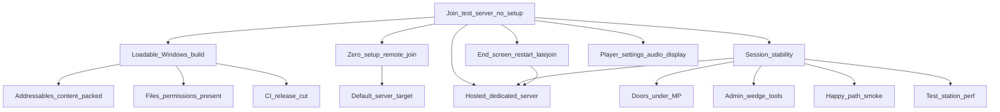

> Goal: A stranger clicks the latest GitHub release link, downloads, and joins the live test server in a few clicks — no config files, no localhost editing, no technical setup
> Status: in-progress
> Depends on: — (parallel operational track; reuses MVP1 [mvp1-nuke-ops.md](mvp1-nuke-ops.md) M5 round-end loop when it lands, but does not require MVP1 gameplay)
> Current focus: T2 (main menu: paste an address once, then one-click join), T3 (session stability — round/connect lifecycle, doors under MP, remaining admin wedge tools (round controls shipped), smoke happy-path, perf floor), T4 (end screen + restart; latejoin shipped), T7 caps
> Roadmap: Test server — Download a release, click join, play with others on a live server

# Test server — hop-on/off playtest gate

## Playable definition

An **operational** gate, not a gameplay one: it's what makes everything else actually testable by other people. Done when someone with no involvement in the project can:

- Download the latest build from a single GitHub (pre)release link
- Launch it and have it **fully load** — no missing content, catalogs, or files that leave it stuck
- Join the **hosted** test server from the main menu ([main-menu.md](../design/main-menu.md)) — paste the address from Discord once, one click afterwards; once the project lists the server publicly, no address at all
- Play on a server that's actually up, and **stay across rounds** — rounds end and loop back so players hop on/off without a restart
- **Session stability**: round start/stop and connect/disconnect are graceful on both server and client; no gross host-vs-client sync failures; **doors/airlocks usable for remote clients**; round-start assignment can’t fail silently; latejoin doesn’t softlock
- Host has **admin wedge tools** when a playtest sticks (force-end round, reassign, teleport disk)
- **Basic player settings**: volume and resolution/window mode/graphics quality can be changed and persist across restarts
- A **smoke / harness path** covers the Nuke Ops happy path (spawn→fight→breach→arm→end→restart) so merges don’t silently re-break the loop
- The authored **test station stays performant** enough for ~8 players + blast + atmos without hitching the session into unplayability

The release zips now load and run (T1, verified by the owner on stable releases v0.3.x). What the artifact still lacks is a front door: shipped launch scripts still target `127.0.0.1` and the client `.bat` prompts for an IP, and the in-game Launcher only appears without arguments (T2). The sandbox server is live on TomNAS, hosted outside this repo. So far only the owner has played a release; no outside tester has.

## Dependency tree

Edges mean “needs.” Leaves cite architecture efforts / system maps / design — not full HOW.

- **Loadable build (shipped)** — release zips package `Config/`, `Data/Tilemaps/` and `Data/StationTemplates/`; `Start_SS3D_Host.bat` passes an explicit `-ip=127.0.0.1` to avoid the IPv6 link-local disconnect (see [networking-session](../architecture/systems/networking-session.md) pitfalls). The owner hosted, dogfooded and joined a sandbox server on stable v0.3.x releases.
- **Zero-setup remote join** — the game opens to a main menu with recent servers, a project-maintained public list and direct connect; no `.bat` or IP prompts ([main-menu.md](../design/main-menu.md) §2–§5). No address is baked in as a default ([sandbox-server.md](../design/sandbox-server.md) §2). Today launch bats hardcode or prompt for an IP ([`Builds/`](../../Builds/); [networking-session](../architecture/systems/networking-session.md)).
- **Session stability** — foundations shipped ([2026-07_headless-dedicated-server.md](../archive/architecture/2026-07_headless-dedicated-server.md), [2026-07_session-world-lifecycle.md](../archive/architecture/2026-07_session-world-lifecycle.md)); still **partial**. Covers: graceful round start/stop + connect/disconnect; no silent mind→spawn→loadout failures; remote drop/selection break; **doors/airlocks under MP**; host admin wedge tools; happy-path smoke ([Multiplayer testing](../architecture/systems/networking-session-testing.md)); test-station performance floor.
- **Player settings (audio + display)** — [2026-10_player-settings.md](../architecture/2026-10_player-settings.md) Phases 1–2; controls rebinding (Phase 3) is outside this gate.
- **End-game screen + restart + latejoin** — shared with MVP1 M5 ([round-end.md](../design/round-end.md) §5–§6; [lobby.md](../design/lobby.md) §7). Latejoin as ghost or late crew must not brick the session; ghosts must still receive the end screen.

## Slices

| Id | Name | Status | Links | Player view |
|----|------|--------|-------|-------------|
| T0 | CI release-cut path | shipped | [2026-07_ci-develop-release-pipeline.md](../architecture/2026-07_ci-develop-release-pipeline.md) | Releases are built automatically, so there's always a download |
| T1 | Loadable build (content + permissions) | shipped — owner-verified on stable v0.3.x releases: host loads the packaged station templates, and the client joins a server | [2026-07_ci-develop-release-pipeline.md](../architecture/2026-07_ci-develop-release-pipeline.md); [networking-session](../architecture/systems/networking-session.md) | The downloaded build loads and runs |
| T2 | Zero-setup remote join: main menu, recent servers, public list, direct connect | pending — **focus** (designed: [main-menu.md](../design/main-menu.md)) | [main-menu.md](../design/main-menu.md); [networking-session](../architecture/systems/networking-session.md); [`Builds/`](../../Builds/) | The game opens to a main menu: paste a server address once, then join in one click |
| T3 | Session stability (lifecycle, doors under MP, admin wedge, happy-path smoke, perf floor) | partial — **focus** (admin names need a server-side token on dedicated servers; `-openbuild` sandbox map editing with throttling and own-edit undo implemented; SS13-scale perf + underfloor MeshRenderer occlusion shipped; Server Settings start/force/extend/cancel/stop wedge shipped; stop before Ongoing cancels the start; local validate.sh PlayMode/server-build/smoke loop shipped; doors/remote drop-selection/reassign/teleport still open; CI smoke not passing since 2026-10-01) | [networking-session](../architecture/systems/networking-session.md); [furniture](../architecture/systems/furniture.md) (airlocks); [2026-07_metastation-scale-perf.md](../archive/architecture/2026-07_metastation-scale-perf.md); [rounds-lobby](../architecture/systems/rounds-lobby.md) (round controls); [ingame-console](../architecture/systems/ingame-console.md) / [admin-tools.md](../design/admin-tools.md); [Multiplayer testing](../architecture/systems/networking-session-testing.md) | Multiplayer sessions stay stable: doors work, admins can unstick a round, no lag spikes |
| T4 | End-game screen + round restart + latejoin (no softlock; spectator sees outcome) | partial — **focus** (latejoin from first attachment + late join after an earlier round shipped; end screen/restart pending); shared with MVP1 M5 | [round-end.md](../design/round-end.md) §5–§6; [lobby.md](../design/lobby.md) §7; [mvp1-nuke-ops.md](mvp1-nuke-ops.md) M5 | Rounds end with a summary screen and restart; you can join mid-round (joining mid-round works) |
| T6 | Player settings: audio + display | shipped | [2026-10_player-settings.md](../architecture/2026-10_player-settings.md) Phases 1–2 | You can change volume, resolution and graphics quality, and they stay set |
| T7 | Sandbox server (open build, 20-min auto-reset, respawn, reset telemetry) | partial (profile, lockdown, auto-reset, respawn, telemetry, `/bug` and the F8 bug report dialog built; the owner's first sandbox session filed #111–#118, all fixed; live on TomNAS, hosted outside this repo; caps pending) | [sandbox-server.md](../design/sandbox-server.md); [2026-11_sandbox-server.md](../architecture/2026-11_sandbox-server.md) | A separate server where everyone can build and fight, and the station resets every 20 minutes (live, address shared in Discord) |
| T5 | Test-server playable close | pending | depends T1–T4, T6 | Finish line: a stranger downloads the latest release and plays on the live test server |

## Explicitly deferred

- Player accounts / real authentication ([player-accounts.md](../design/player-accounts.md)).
- Server browser / matchmaking.
- Auto-deploy of new builds to the host, and persistence across server restarts.
- Windows dedicated-server build / Windows smoke — host on Linux per CI effort.
- Full lobby visual redesign — minimal join/spawn path is enough ([lobby.md](../design/lobby.md)).

## Maintenance

When child work ships, run `update-system-docs`: bump slice status + header `Current focus`, refresh [INDEX.md](INDEX.md). Keep T4 in sync with MVP1 M5 and T1 in sync with [map-authoring.md](map-authoring.md) A1. Keep T3 as the home for multiplayer session stability / doors / admin / smoke / perf (do not duplicate parallel MVP1 networking slices). Record T1 root cause in the relevant system map **Pitfalls** once known.
